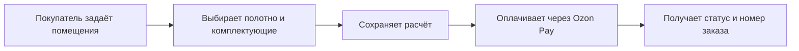

# Новый сайт KRAZBURG

Обновлённый сайт сохраняет действующий конструктор и оформление заказа через Ozon Pay. Основные изменения — новый дизайн и CMS Strapi для управления содержанием сайта, видами потолков и опциями конструктора.

Покупатель проходит привычный сценарий в обновлённом интерфейсе. Сотрудники меняют контент и предусмотренные настройки через CMS. Границы работ определены в [пункте 1](./project/overview.md#p-1).

Основные функции: [конструктор](./spec/constructor.md#p-2), [каталог и опции](./spec/catalog.md#p-4), [заказы и оплата](./spec/leads.md#p-5), [управление сайтом через CMS](./spec/admin.md#p-6). Система реализуется на Nuxt и Strapi согласно [архитектуре](./spec/architecture.md#p-7).
