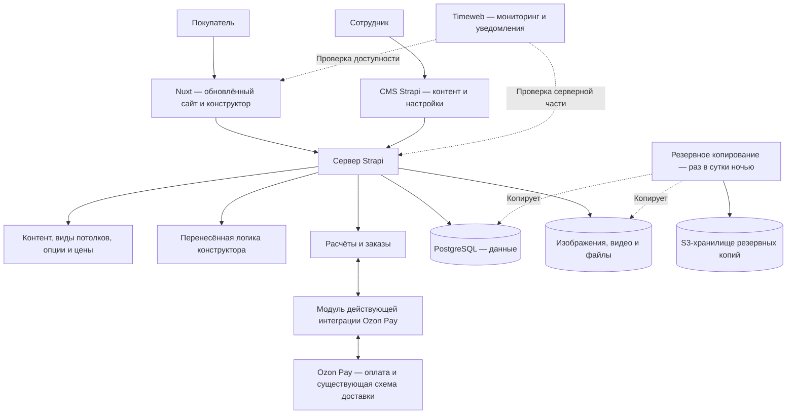

# 7. Архитектура и эксплуатация {#p-7}

Новый интерфейс реализуется на Nuxt. Strapi служит CMS и основой серверной части. Алгоритмы существующего конструктора, оформление заказов и подключение Ozon Pay переносятся с сохранением поведения.

## 7.1. Состав системы {#p-7-1}

| Часть | Назначение |
| --- | --- |
| Nuxt | Показывает страницы и конструктор в новом дизайне, сохраняя сценарии покупателя |
| CMS Strapi | Управляет текстами, медиа, видами потолков, опциями, товарами и ценами |
| Модули расчёта и заказов | Выполняют перенесённую логику, сохраняют проекты и поддерживают оформление |
| Интеграция Ozon Pay | Сохраняет создание оплаты, проверку статуса и действующую схему получения заказа |
| PostgreSQL | Хранит содержание сайта, настройки и данные перенесённых модулей |
| Timeweb | Проверяет доступность системы и автоматически сообщает о сбоях |
| S3-хранилище | Хранит резервные копии данных и загруженных файлов |

Настройки поступают из CMS, алгоритмы выполняются серверными модулями. Новая цена или опция меняет данные расчёта; изменение самого способа вычисления требует изменения программной логики.

## 7.2. Мониторинг {#p-7-2}

### 7.2.1. Проверка доступности {#p-7-2-1}

Мониторинг доступности сайта и серверной части выполняется средствами Timeweb.

### 7.2.2. Уведомления о сбоях {#p-7-2-2}

Timeweb автоматически сообщает о сбоях средствами своего сервиса мониторинга.

## 7.3. Резервное копирование {#p-7-3}

### 7.3.1. Ежедневная ночная копия {#p-7-3-1}

Раз в сутки в ночное время выполняется одно резервное копирование базы данных и загруженных файлов. Результат сохраняется в S3-хранилище.

### 7.3.2. Восстановление данных {#p-7-3-2}

Резервная копия должна позволять восстановить базу данных и загруженные файлы.

## 7.4. Перенос и запуск {#p-7-4}

### 7.4.1. Перенос логики и данных {#p-7-4-1}

Товары, цены, параметры и содержимое сайта переносятся в Strapi. При переносе алгоритмов используются исходники действующего проекта и контрольные сценарии. При одинаковых размерах, опциях и ценах новый сайт выдаёт такой же состав и сумму.

### 7.4.2. Действующие расчёты и заказы {#p-7-4-2}

При переключении сайта сохраняются ранее созданные действующие расчёты, сведения об оплаченных заказах и возможность открыть их по существующим ссылкам. Порядок переноса и переключения оплаты определяется по исходникам и данным действующего сервера до запуска нового сайта.
