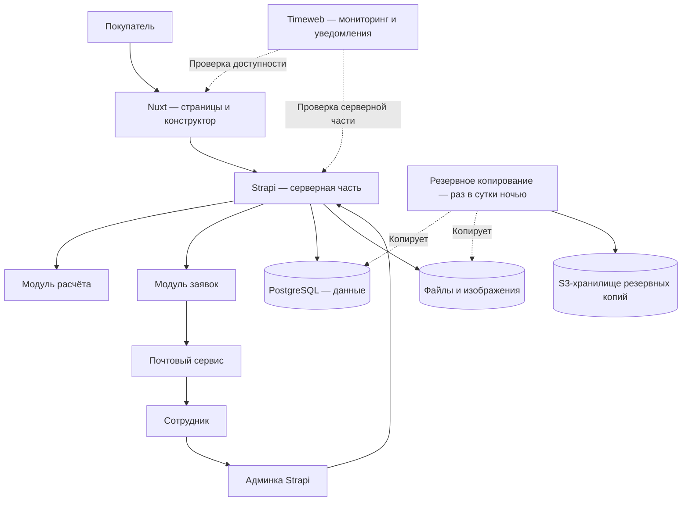

# 7. Архитектура и эксплуатация {#p-7}

Сайт работает на Nuxt, серверная часть и админка — на Strapi. Данные хранятся в PostgreSQL.

## 7.1. Состав системы {#p-7-1}

| Часть | Назначение обычными словами |
| --- | --- |
| Nuxt | Показывает страницы, параметры и схему помещения |
| Strapi | Хранит каталог и настройки, проверяет расчёт, принимает заявки и предоставляет админку |
| PostgreSQL | Хранит структурированные данные системы |
| Почтовый сервис | Доставляет менеджеру уведомления о заявках |
| Timeweb | Проверяет доступность системы и автоматически сообщает о сбоях |
| S3-хранилище | Хранит резервные копии данных и загруженных файлов |

## 7.2. Мониторинг {#p-7-2}

### 7.2.1. Проверка доступности {#p-7-2-1}

Мониторинг доступности сайта и серверной части выполняется средствами Timeweb.

### 7.2.2. Уведомления о сбоях {#p-7-2-2}

Timeweb автоматически сообщает о сбоях средствами своего сервиса мониторинга.

## 7.3. Резервное копирование {#p-7-3}

### 7.3.1. Ежедневная ночная копия {#p-7-3-1}

Раз в сутки в ночное время выполняется одно резервное копирование базы данных и загруженных файлов. Результат сохраняется в S3-хранилище.

### 7.3.2. Восстановление данных {#p-7-3-2}

Резервная копия должна позволять восстановить базу данных и загруженные файлы.

## 7.4. Следующий этап {#p-7-4}

Корзина, оформление заказа, оплата и доставка относятся к последующему развитию и потребуют отдельной торговой логики.
