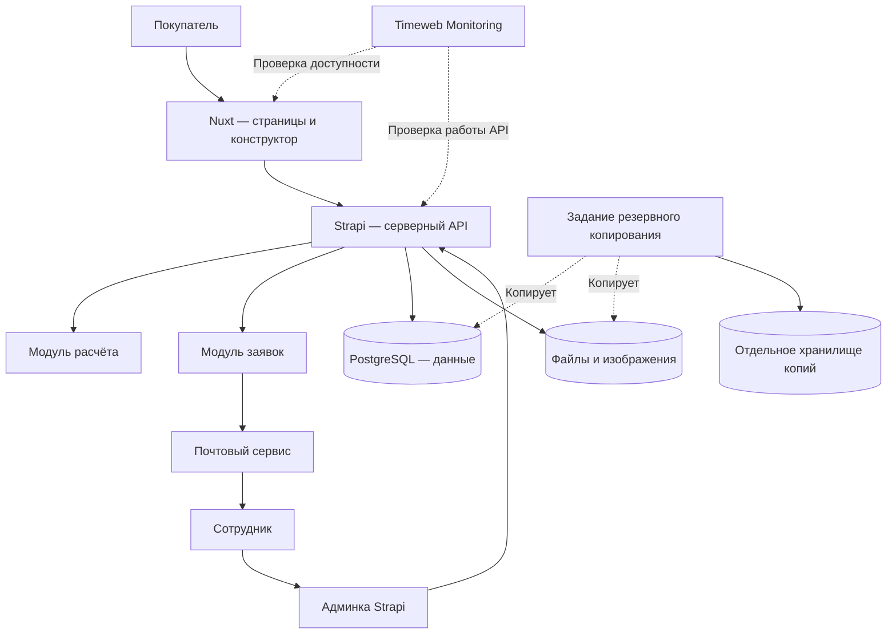

# Архитектура и эксплуатация

::: info Предварительная архитектура
Схема отражает выбранные части системы. Размер серверов, способы размещения и параметры восстановления ещё нужно согласовать.
:::

## Состав системы

| Часть | Назначение обычными словами |
| --- | --- |
| Nuxt | Показывает страницы, параметры и схему помещения |
| Strapi | Хранит каталог и настройки, проверяет расчёт, принимает заявки и предоставляет админку |
| PostgreSQL | Хранит структурированные данные системы |
| Почтовый сервис | Доставляет менеджеру уведомления |
| Timeweb Monitoring | Проверяет, доступен ли сайт и работает ли серверная часть |
| Резервное копирование | Позволяет восстановить данные и загруженные файлы |

## Мониторинг и резервное копирование

Мониторинг и копии работают отдельно от действий покупателя. Нужно согласовать проверки, получателей уведомлений, расписание и срок хранения копий, допустимую потерю данных, время восстановления и проверку восстановления из копии.

## Следующий этап

Корзина, оформление заказа, оплата и доставка потребуют отдельной торговой логики. Strapi не рассматривается как готовый торговый движок с этими возможностями.
