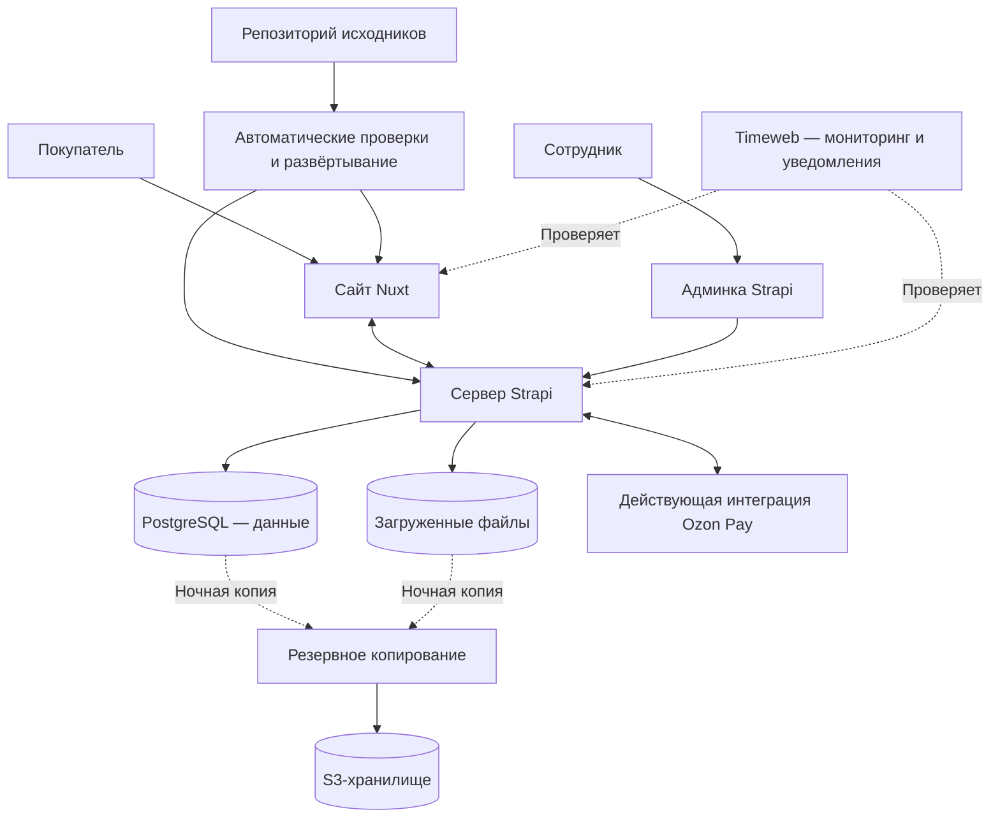

# 3. Сайт и окружение {#p-3}

## 3.1. Интерфейс на Nuxt {#p-3-1}

Фронтенд переписывается на Nuxt и получает контент и настройки из Strapi. Текущий дизайн сайта и конструктора воспроизводится на компьютере и телефоне.

## 3.2. Архитектура {#p-3-2}

## 3.3. Подготовка и запуск {#p-3-3}

Настраиваются окружение разработки, сервер, база данных, домен и HTTPS. Сайт разворачивается на сервере заказчика; перенесённые данные и интеграции проверяются до переключения рабочего домена.

Для фронтенда и бэкенда настраиваются пайплайны: при обновлении кода в рабочей ветке запускаются проверки, после их успешного завершения изменения автоматически разворачиваются на сервере.

## 3.4. Мониторинг {#p-3-4}

Timeweb проверяет доступность сайта и серверной части и автоматически сообщает о сбоях.

## 3.5. Резервное копирование {#p-3-5}

Раз в сутки ночью создаётся одна резервная копия базы данных и загруженных файлов в S3-хранилище. При настройке проверяется восстановление из копии.

## 3.6. Самостоятельные доработки {#p-3-6}

Заказчик получает исходники фронтенда и бэкенда и может изменять их самостоятельно. В `AGENTS.md` описываются структура проекта, запуск, проверки, правила внесения изменений и развёртывание. Передаются настройки пайплайнов, перечень переменных окружения и доступы, необходимые для продолжения работы.
