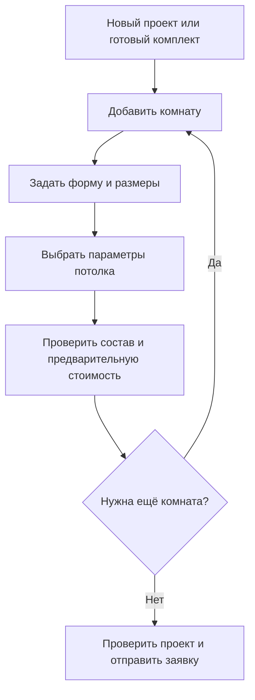

# Конструктор

Покупатель задаёт помещения, выбирает параметры потолка и получает состав комплекта с предварительной стоимостью.

## Путь покупателя

## Принятые ограничения

Один проект может содержать несколько комнат. План каждой комнаты — замкнутый многоугольник из прямых стен, в том числе с нишами и непрямыми углами. Кривые, несколько уровней и данные для производственного раскроя не входят в первый этап.

Черновик сохраняется в том же браузере без регистрации. Продолжение расчёта на другом устройстве в первый этап не входит.

## Решения для согласования

Способ ввода размеров, проверки геометрии, размещение дополнительных элементов, правила замены комплектующих и поведение на телефоне. Детальные макеты пока не утверждены.
