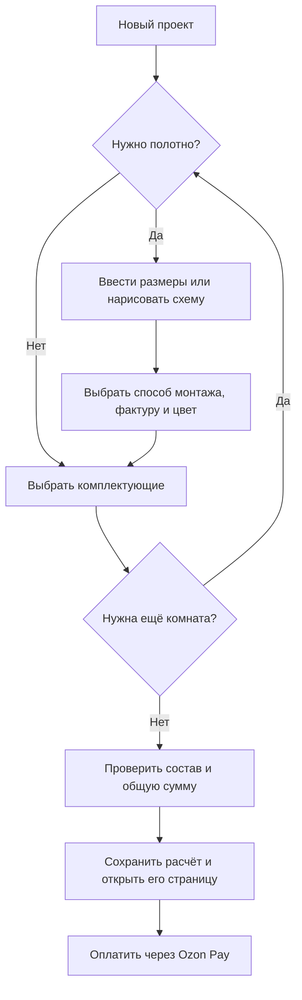

# 2. Конструктор {#p-2}

За основу берётся действующий конструктор. Обновляется его оформление и подключается управление данными через CMS; способы расчёта и путь оформления заказа сохраняются.

## 2.1. Путь покупателя {#p-2-1}

## 2.2. Помещения и схема {#p-2-2}

### 2.2.1. Несколько комнат {#p-2-2-1}

Один проект может содержать несколько комнат. Покупатель добавляет комнаты, переключается между ними и удаляет ненужные. У каждой комнаты свои размеры, параметры потолка и комплектующие; сумма проекта объединяет все комнаты.

### 2.2.2. Форма помещения {#p-2-2-2}

План комнаты — замкнутый многоугольник из прямых стен, в том числе с нишами и непрямыми углами. Сохраняется действующий расчёт геометрии. Если контур определяется приблизительно, схема, площадь и стоимость обозначаются как эскиз с необходимостью уточнить замеры до изготовления.

### 2.2.3. Наглядное представление {#p-2-2-3}

Для прямоугольной комнаты покупатель вводит длину и ширину в сантиметрах. Для сложной формы отмечает углы на сетке, замыкает контур и последовательно задаёт длины стен. Форма, подписи сторон, площадь и периметр показываются на 2D-схеме. Ввод сохраняется для клавиатуры, мыши и сенсорного экрана.

### 2.2.4. Проверки и ограничения размеров {#p-2-2-4}

Сохраняются действующие проверки замкнутости и допустимости контура, заполненности размеров и ограничений сторон. Если размеры превышают возможности доступных полотен, оформление расчёта блокируется и покупателю предлагается согласовать решение с технологом. Числовые ограничения берутся из предусмотренных настроек конструктора.

## 2.3. Сохранение расчёта {#p-2-3}

### 2.3.1. Черновик в браузере {#p-2-3-1}

Незавершённый расчёт автоматически сохраняется в том же браузере без регистрации. После обновления или повторного открытия страницы восстанавливаются комнаты, активная комната, размеры, параметры полотна и комплектующие. Оформленный расчёт доступен по своей ссылке согласно [разделу 5](./leads.md#p-5).

### 2.3.2. Сброс проекта {#p-2-3-2}

Сброс требует повторного подтверждения и возвращает конструктор к одной пустой комнате. В новом дизайне предупреждение должно быть видно до удаления введённых данных.

## 2.4. Параметры и обновлённый интерфейс {#p-2-4}

### 2.4.1. Способ монтажа, фактура и цвет {#p-2-4-1}

Сохраняются классическая натяжка, монтаж с домашним феном и холодная натяжка. Доступные фактуры, цвета и способы монтажа зависят от совместимости и размеров. Названия, описания, изображения и варианты выбора управляются через CMS.

### 2.4.2. Выбор комплектующих {#p-2-4-2}

Покупатель открывает группы комплектующих, выбирает позиции и задаёт количество или длину. Сохраняются единицы продажи, кратность упаковки и правила округления. Можно рассчитать полотно отдельно, с комплектующими либо заказать только комплектующие. Состав и сумма обновляются при изменении выбора.

### 2.4.3. Изменение размеров и выбора {#p-2-4-3}

После изменения размеров повторно проверяются допустимые способы монтажа и сочетания полотна. Сохраняются действующие правила автоматической смены недоступного варианта и сброса комплектации: при изменении периметра более чем на 0,5 м либо числа углов выбранные комплектующие очищаются. Покупатель видит пояснение о сбросе.

### 2.4.4. Новый дизайн {#p-2-4-4}

По согласованным макетам обновляются компоновка, оформление полей, выбор полотна, каталог комплектующих, схема комнаты, состав и итоговая сумма. На телефоне должны быть доступны все действия существующего конструктора, включая построение схемы и ввод размеров экранной клавиатурой.
