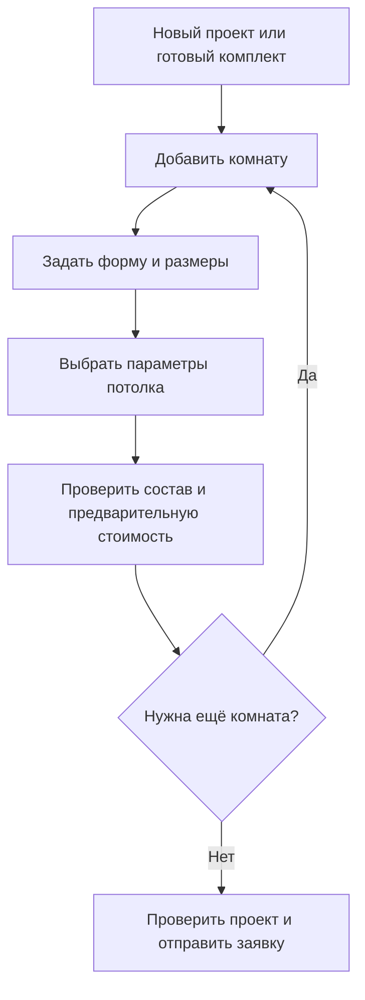

# 2. Конструктор {#p-2}

Покупатель задаёт помещения, выбирает параметры потолка и получает состав комплекта с предварительной стоимостью.

## 2.1. Путь покупателя {#p-2-1}

## 2.2. Помещения и схема {#p-2-2}

### 2.2.1. Несколько комнат {#p-2-2-1}

Один проект может содержать несколько комнат. У каждой комнаты свои размеры, параметры потолка и комплект.

### 2.2.2. Форма помещения {#p-2-2-2}

План комнаты — замкнутый многоугольник из прямых стен, в том числе с нишами и непрямыми углами. Кривые, несколько уровней и данные для производственного раскроя не входят в первый этап.

### 2.2.3. Наглядное представление {#p-2-2-3}

Форма и размеры помещения показываются на 2D-схеме. Способ ввода размеров и проверки геометрии будет уточнён после изучения текущего конструктора.

## 2.3. Сохранение расчёта {#p-2-3}

### 2.3.1. Черновик в браузере {#p-2-3-1}

Незавершённый расчёт автоматически сохраняется в том же браузере без регистрации. Продолжение расчёта на другом устройстве в первый этап не входит.

## 2.4. Детали для уточнения {#p-2-4}

Размещение дополнительных элементов, правила замены комплектующих и поведение на телефоне будут уточнены после изучения текущего сайта и подготовленных макетов.
