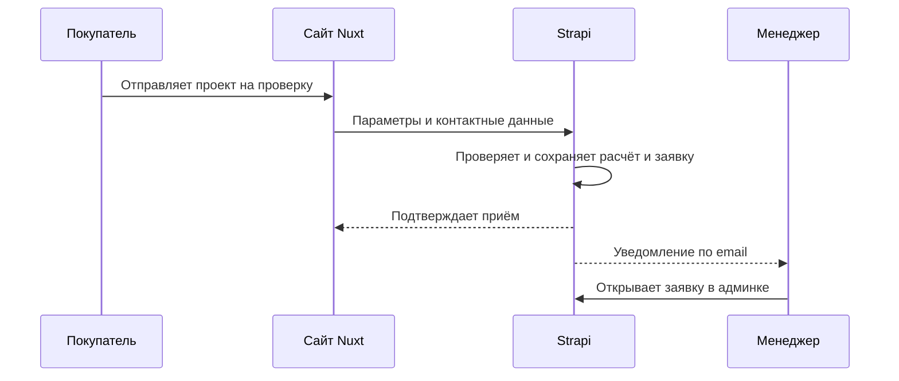

# Заявки

## Согласованный сценарий

Менеджер работает с заявкой в Strapi и проверяет предварительный расчёт перед изготовлением. Онлайн-оплата и автоматическая доставка не включены в первый этап.

## Требует уточнения

Необходимо согласовать контактные поля, тексты согласий, перечень статусов и комментарии менеджера. Также требуется выбрать поведение при повторной отправке заявки и при недоставленном уведомлении по email.
