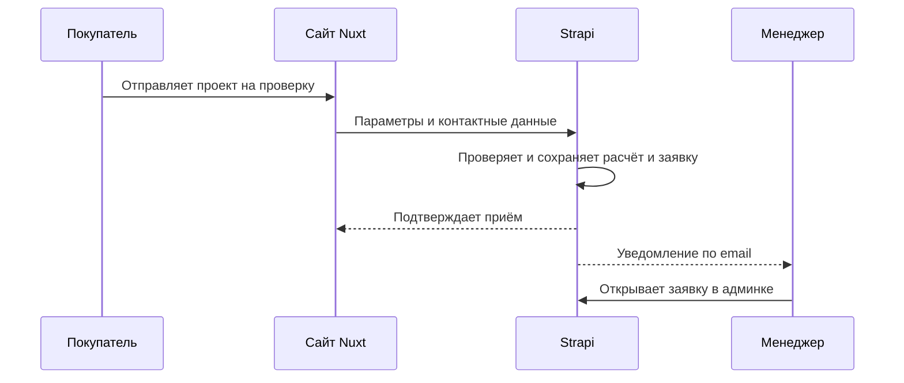

# 5. Заявки {#p-5}

## 5.1. Передача расчёта {#p-5-1}

## 5.2. Обработка заявки {#p-5-2}

### 5.2.1. Сохранение {#p-5-2-1}

Расчёт проекта и контактные данные покупателя сохраняются в Strapi и доступны менеджеру в админке.

### 5.2.2. Уведомление менеджера {#p-5-2-2}

После приёма заявки менеджеру отправляется уведомление по email.

### 5.2.3. Проверка перед изготовлением {#p-5-2-3}

Менеджер работает с заявкой в Strapi и проверяет предварительный расчёт перед изготовлением. Онлайн-оплата и автоматическая доставка не включены в первый этап.

## 5.3. Детали для уточнения {#p-5-3}

После изучения текущего сайта будут уточнены контактные поля, тексты согласий, статусы, комментарии менеджера, поведение при повторной отправке заявки и при недоставленном уведомлении по email.
