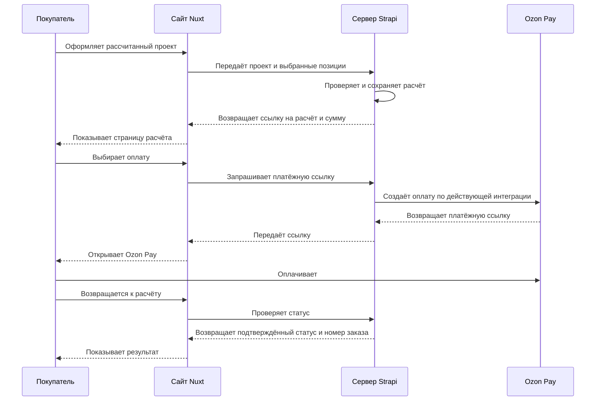

# 5. Расчёты, заказы и оплата {#p-5}

Сохраняется действующее оформление: покупатель сохраняет расчёт, открывает его отдельную страницу, оплачивает через Ozon Pay и получает подтверждение заказа.

## 5.1. Путь покупателя {#p-5-1}

## 5.2. Оформление и оплата {#p-5-2}

### 5.2.1. Сохранённый расчёт {#p-5-2-1}

Сохраняются все комнаты, размеры и схемы, параметры полотна, комплектующие, количества, сумма и версия цен. Расчёт доступен по отдельной ссылке. Страница показывает состав по комнатам, общую сумму и предусмотренные действующей логикой сведения о доставке.

### 5.2.2. Оплата через Ozon Pay {#p-5-2-2}

Покупатель получает платёжную ссылку и переходит в Ozon Pay. Сохраняются доступные в действующем подключении способы оплаты и порядок возврата на сайт.

### 5.2.3. Подтверждение и получение заказа {#p-5-2-3}

После подтверждения оплаты сайт показывает номер заказа и дальнейшие действия. Сохраняется действующий вариант доставки: выбор пункта выдачи при оплате либо уточнение через чат Ozon в зависимости от настройки существующей интеграции. Доставка и обработка заказов продолжают работать по текущей схеме.

### 5.2.4. Статусы {#p-5-2-4}

| Состояние | Что видит покупатель |
| --- | --- |
| Расчёт готов | Сумму, состав, срок действия и переход к оплате |
| Ожидание оплаты | Платёжную ссылку и состояние проверки подтверждения |
| Оплачено | Подтверждение, номер заказа и дальнейшие действия |
| Срок расчёта истёк | Возможность открыть проект и пересчитать по текущим ценам |
| Расчёт отменён | Возможность вернуться в конструктор |
| Оплата временно недоступна | Сообщение о недоступности и сохранённую ссылку на расчёт |

Оплата подтверждается серверным статусом. Возврат покупателя со страницы Ozon Pay сам по себе не считается подтверждением платежа.

### 5.2.5. Сроки и повторная попытка {#p-5-2-5}

Сохраняются предусмотренные действующим сценарием сроки: сумма расчёта фиксируется на 24 часа, платёжная ссылка действует 15 минут. Пока расчёт действует, покупатель может получить новую ссылку. После истечения расчёта его можно открыть в конструкторе и пересчитать. При сбое связи предусмотрены повторная проверка статуса и понятное сообщение. Серверные параметры подтверждаются при переносе согласно [пункту 9.1.1](../project/questions.md#p-9-1-1).

### 5.2.6. Возврат к проекту {#p-5-2-6}

Покупатель может скопировать ссылку, открыть расчёт повторно и вернуть проект в конструктор для изменения. Изменение проекта не подменяет состав уже оплаченного заказа.

### 5.2.7. Изменение цен в CMS {#p-5-2-7}

Сохранённый расчёт хранит состав и цены на момент оформления. Изменение каталога в CMS не меняет его сумму в течение срока действия. Если цены изменились до сохранения расчёта, сайт обновляет сумму и предлагает проверить её перед повторным оформлением, как в действующем сценарии.

## 5.3. Перенос действующей интеграции {#p-5-3}

Оформление, получение платёжных ссылок, проверка статусов и обработка заказов переносятся на основе серверных исходников и настроек действующего сайта. При подключении CMS эти сценарии сохраняются. Необходимые материалы перечислены в [разделе 9](../project/questions.md#p-9).
