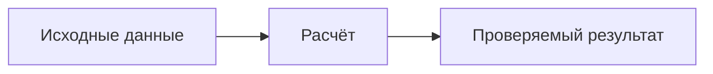

# Правила оформления

Документация должна быть понятна заказчику без опыта программирования. Сначала описывайте действие человека и результат, затем необходимые технические условия.

## Нумерация требований

Нумерация записывается прямо в Markdown: разделы — `1.`, подразделы — `1.1.`, отдельные требования — `1.1.1.`. Главы закреплены за страницами: 1 — задача проекта, 2 — конструктор, 3 — расчёт, 4 — каталог, 5 — заявки, 6 — сотрудники, 7 — архитектура, 8 — приёмка, 9 — вопросы. Главная страница служит обложкой.

У каждого пронумерованного заголовка задавайте явный якорь, например `### 7.3.1. Ночное копирование {#p-7-3-1}`. Ссылки на конкретный пункт используйте с этим якорем. Изменение текста заголовка не должно менять его адрес. Номера должны совпадать в тексте, меню и ссылках.

## Статусы сведений

| Статус | Что означает |
| --- | --- |
| Согласовано | Решение принято в обсуждении с заказчиком |
| Проверено | Есть воспроизводимое наблюдение и ссылка на источник |
| Предложение | Решение ещё нужно обсудить |
| Открытый вопрос | Не хватает конкретных данных |

Не смешивайте существующее поведение, предложения и утверждённые требования. Формулы и нормы расхода сопровождайте проверочными примерами.

## Mermaid

Пишите диаграммы обычным блоком с языком `mermaid`. После открытия страницы появятся масштабирование, полноэкранный просмотр и скачивание SVG.

````md

````

Используйте короткие русские подписи. Для процесса подойдёт `flowchart`, для обмена между частями системы — `sequenceDiagram`, для жизненного цикла — `stateDiagram-v2`.

## Таблицы и пояснения

Таблицы подходят для вариантов, правил и критериев приёмки. У требования указывайте условие, действие и ожидаемый результат. Слова «удобный», «современный» или «масштабируемый» заменяйте наблюдаемыми признаками.

::: tip Пояснение для заказчика
Короткое объяснение термина можно оформить таким блоком. Существенные ограничения остаются в основном тексте.
:::

## Примеры команд

::: code-group
```bash [Разработка]
npm run docs:dev
```
```bash [Сборка]
npm run docs:build
```
```bash [Просмотр сборки]
npm run docs:preview
```
:::

Изображения и небольшие Vue-компоненты можно добавлять в соответствующий раздел после согласования макетов. Библиотеки, работающие только в браузере, подключайте с учётом серверной сборки VitePress. Подробнее — [пакеты и публикация](./tooling.md).
