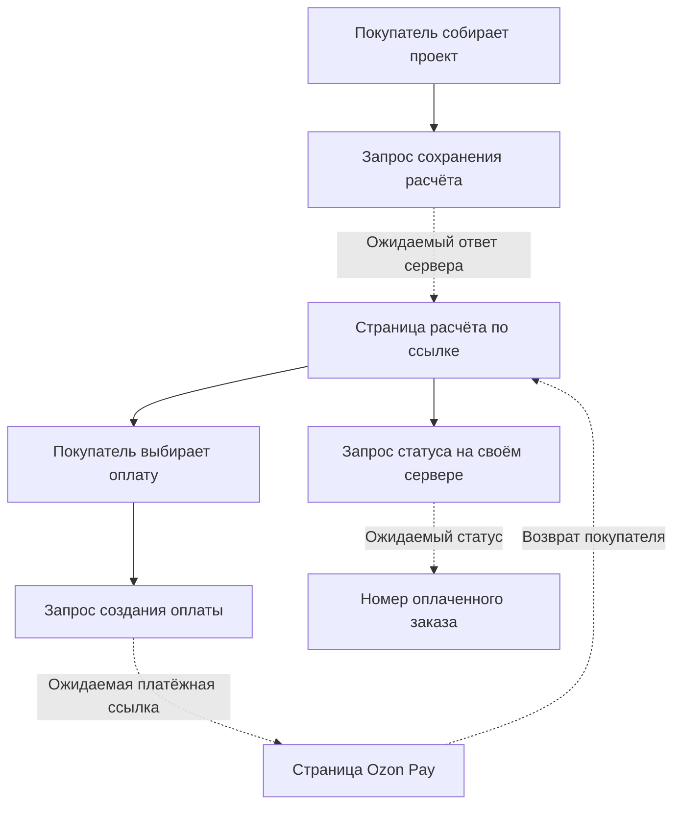

# Сохранённый расчёт и Ozon Pay: проверка 5 ноября 2026 года

> **Актуализация границ работ:** заказчик уточнил задачу: CMS и редизайн на Nuxt + Strapi с сохранением конструктора, заказов и Ozon Pay. Прежнее решение о замене оплаты заявкой менеджеру отменено. [Актуальные границы проекта](../project-scope.md) имеют приоритет над историческими выводами ниже.

Исследована публичная страница сохранённого расчёта и её клиентский код. Новые заказы, платёжные ссылки и платежи на настоящем сервере не создавались. Для первого этапа нового проекта сохраняется подтверждённая пользователем заявка менеджеру.

## Что стало доступно

| Источник | Наблюдение |
| --- | --- |
| `/calc/0000000000000000` | Публичная HTML-оболочка, HTTP 200. Идентификатор выбран искусственно, чужие расчёты не открывались |
| `/api/calc.php?id=0000000000000000` | Настоящий GET вернул HTTP 404; браузер показал отсутствие расчёта |
| `/_astro/CalcPage.BsliCBLZ.js` | Новый относительно кэша модуль страницы, HTTP 200, 19 278 байт |

SHA-256 `CalcPage.BsliCBLZ.js`: `082fc7f49c349d0ceddbd67aec3321408ff5ce11b50bc195b47e05e87ef71871`. HTML-оболочка: `07c7dad718975716c6c9dc300d08d11527a9e115225fb18444f729783958dce5`.

Исходные ответы, форматированная копия `CalcPage.formatted.js`, сценарий проверки и результаты находятся в `research/live-2026-11-05/checkout/`. Номера строк ниже относятся к этой форматированной копии. В Git сохранён только отчёт.

## Предусмотренный сценарий

По клиентскому коду путь состоит из двух отдельных операций: сохранение расчёта и создание оплаты. Страница расчёта явно называет платёжный этап **Ozon Pay**; это уточняет прежний вывод по кэшу, где был известен только общий переход к оплате через Ozon.

1. Конструктор отправляет проект, изображения схем и комплектации, сумму и версию прайса на `/api/calc.php`. Это уже установлено исследованием кэша.
2. Сервер должен вернуть идентификатор, срок действия, сумму и адрес страницы расчёта. Конструктор перенаправляет покупателя на полученный адрес.
3. Страница `/calc/{id}` запрашивает сохранённый расчёт GET-запросом. Поддерживается также идентификатор в параметре `id` (строки 66–90).
4. Если расчёт допускает оплату, покупатель нажимает платёжную кнопку. Клиент отправляет идентификатор на `/api/pay.php`, ожидает `paymentUrl` и перенаправляет браузер на этот адрес (109–119).
5. При возвращении с `payment=success` или `payment=fail` параметр снимается с адреса, а данные снова запрашиваются у своего сервера. Сам параметр успешного возврата не переводит расчёт в оплаченный (73–85).
6. В ожидании подтверждения клиент опрашивает `/api/calc-status.php`. Номер заказа и состояние оплаты берутся из ответа своего сервера (16–54, 92–100).

## Доставка и получение заказа

Клиент предусматривает два варианта, задаваемых серверным полем `payment.delivery` (143–163):

| Вариант | Что объясняет интерфейс |
| --- | --- |
| `ozon` | На странице Ozon Pay покупатель выбирает пункт выдачи и оплачивает; после оплаты ожидается доставка в выбранный пункт, сведения о доставке — в приложении Ozon |
| `chat` | После оплаты покупатель передаёт номер заказа в чат Ozon, где уточняется пункт выдачи |

Оба варианта отображают доставку как включённую в сумму. В клиенте указаны оплата картой, СБП или Ozon Картой. Это описание предусмотренного интерфейса; доступность способов, выбор пункта выдачи и реальное исполнение заказа не проверялись.

Поэтому Ozon Pay здесь задуман как отдельный платёжный этап с возможной связью с доставкой. Серверный метод интеграции и фактическая работа доставки по одному клиентскому коду не устанавливаются.

## Состояния страницы

| Состояние | Возможности клиента |
| --- | --- |
| Загрузка | Показывает промежуточное состояние до получения данных |
| Расчёт отсутствует | Предлагает перейти к новому расчёту |
| Ошибка получения данных | Показывает ошибку и позволяет обновить страницу |
| `ready` | Показывает сумму, срок её действия, редактирование и создание оплаты |
| `pending` | Ожидает подтверждения, показывает оставшееся время ссылки и позволяет вернуться к ней |
| `paid` | Показывает номер заказа и дальнейшие действия с учётом варианта доставки |
| `expired` | Предлагает открыть проект в конструкторе и пересчитать по текущим ценам |
| `cancelled` | Предлагает повторно открыть проект в конструкторе |
| Оплата недоступна | Сохраняет просмотр расчёта, блокирует платёжное действие и предлагает связаться с поддержкой |

Можно скопировать ссылку на расчёт, начать новый и вернуть сохранённый проект в редактор. Для возвращения проекта используется браузерная передача `krazburg:calc-handoff:v1` (100–107). В интерфейсе также предусмотрены признаки тестовой и проверочной оплаты; наличие этих веток не означает, что работающий сервер включён в тестовый режим (125).

## Сроки и повторные проверки

- Текст страницы описывает фиксацию суммы расчёта на 24 часа. Отсчёт строится по `createdAt` и `expiresAt` из сервера; реальное серверное соблюдение срока не проверялось (139–141).
- Для ссылки оплаты в интерфейсе предусмотрено 15 минут и получение новой ссылки при действующем расчёте. Это заложенная логика клиента, а не независимо проверенное ограничение платёжного сервиса (62, 147–153).
- Опрос статуса выполняется примерно каждые 3 секунды в первую минуту, затем каждые 5 секунд до пяти минут, далее каждые 15 секунд. При сбоях интервал увеличивается до 30 секунд (11–14).
- Опрос ограничен часом, учитывает видимость страницы и может запускаться повторно вручную. При возврате на вкладку клиент запрашивает обновление состояния (16–54).

## Проверка отображения без реальных заказов

Единственная проверка настоящего расчётного API — безопасный GET с искусственным несуществующим идентификатором: получены 404 API и состояние отсутствующего расчёта. HTML и статические ресурсы также загружались с работающего сайта.

Дополнительно семь состояний интерфейса показаны в браузере с **синтетическими ответами**, подставленными локально: `ready`, `pending`, оплаченное с доставкой Ozon, оплаченное с уточнением через чат, `expired`, `cancelled` и недоступная оплата. Во всех случаях отрисовка прошла без JavaScript-ошибок. Такие снимки подтверждают ветки интерфейса, но не серверные переходы и не настоящую оплату.

Артефакты имеют префикс `SYNTHETIC-`; данные примера и номер заказа искусственные. Результат записан в `runtime-results.json`. POST-запросы блокировались, платёжные действия и ссылки не запускались.

## Что остаётся неподтверждённым

Серверное создание и защита расчёта, получение реальной платёжной ссылки, метод подключения Ozon Pay, проверка подлинности уведомлений, фактический платёж, возвраты и доставка. Эти части требуют исходников либо отдельного согласованного тестового сценария с владельцем сайта.
